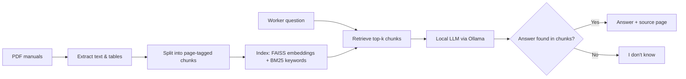

# FactoryDocs Assistant

**A Retrieval-Augmented Chatbot for Robot Error Diagnosis in Production**

> Case Study: Intelligent Systems in Production (MDM-2) · Deggendorf Institute of Technology (THD)
> Track: Software & Simulation · Lecturer: Hamidreza Heidari, PhD


---

## About the project

Collaborative robots like the Universal Robots UR5e are widely used in production, for example to load CNC machines or pick and place parts. In real operation, the robot often stops itself for safety (a protective stop) and shows an error code, such as C153 (position deviates from path) or C157 (collision detected by joint). When the robot stops, the connected machine and material flow stop too.

The cause and the fix are spread across several long manuals: the error code directory, the robot user manual, the gripper manual and the service handbook. Workers often describe the problem in their own words, which simple keyword search (Ctrl+F) cannot handle. General AI chatbots can give confident but wrong answers, which can damage machines or hurt people.


**FactoryDocs Assistant** lets the worker type the error code or the problem and answers **only** from these manuals, using Retrieval-Augmented Generation (RAG):

- Finds the relevant part of the manual
- A local language model writes a short answer
- **Every answer shows the source page**
- If the answer is not in the manuals, it says **"I don't know"** instead of guessing
- Runs **locally** with Ollama, so documents never leave the computer

## Input and output

**Input:** an error code (e.g., "C157A2") or a problem in the worker's own words (e.g., "The robot keeps dropping parts")

**Output:** meaning of the error, likely cause, fix steps, and source pages from the manuals, or "I don't know" if the answer is not in the manuals

## Real-world problem

- Protective stops are commonly caused by a wrong payload setting, collisions, dragging cables or high acceleration [8].
- Universal Robots requires that every protective stop is investigated before restarting: "Protective Stop warning message SHALL NOT be reset without a review to determine the fault's root cause" [8].
- Unplanned downtime costs the world's 500 largest companies about $1.4 trillion per year [7].

## How it works



## What we compare

All four approaches are tested on the same question set:

| # | Approach | Description |
|---|----------|-------------|
| 1 | Plain LLM | No retrieval, answers from the model's memory (shows hallucination risk) |
| 2 | BM25 RAG | Keyword search baseline |
| 3 | Dense RAG | Meaning-based search with sentence embeddings |
| 4 | Hybrid RAG | BM25 + dense search combined (handles exact error codes like C157A2 and problem descriptions) |

We also test different chunk sizes and top-k values.

## Evaluation

**Test set:** 60 team-written questions in 5 types: error code, problem description, multi-document, procedure, and unanswerable.

| KPI | What it measures | Target |
|-----|------------------|--------|
| Retrieval hit rate@5 | Correct page is among the top 5 retrieved chunks | ≥ 80% |
| Answer accuracy | Answer judged correct (3-level rubric, 2 reviewers) | ≥ 75%, beats baselines |
| Refusal rate | Says "I don't know" on unanswerable questions | ≥ 80% |
| Response time | Median seconds per answer on a laptop | ≤ 10 s |

Targets are goals; final results will be added here after the experiments.

## Data

We use four public manuals for the UR5e robot and its gripper. **The PDFs are not stored in this repository** (copyright); download them from the original sources and place them in `data/raw/`.

| Document | What it gives | Source |
|---|---|---|
| UR Error Codes Directory | Meaning and suggested fix for robot error codes | [Universal Robots](https://www.universal-robots.com/manuals/EN/PDF/Shared/ErrorCodes/ErrorCodes.pdf) |
| UR5e User Manual | Robot settings, e.g., payload and safety | [Universal Robots](https://s3-eu-west-1.amazonaws.com/ur-support-site/262292/710-965-00_UR5e_User_Manual_en_Global.pdf) |
| Robotiq 2F-85 / 2F-140 Manual (for UR) | Gripper problems, e.g., dropped parts | [Robotiq](https://assets.robotiq.com/website-assets/support_documents/document/2F-85_2F-140_UR_PDF_20200211.pdf) |
| UR e-Series Service Handbook | Repair and troubleshooting steps | [Universal Robots](https://www.universal-robots.com/download/manuals-e-seriesur-series/service/service-manual-e-series-english/) |

## Tech stack

| Purpose | Tool |
|---------|------|
| PDF extraction | pdfplumber (PyMuPDF as backup) |
| Embeddings | sentence-transformers |
| Vector search | FAISS |
| Keyword search | rank-bm25 |
| Language model | Ollama (e.g., Llama 3 8B), runs locally |
| Evaluation | pandas, RAGAS |
| Demo app | Streamlit |

## Repository structure (planned)

```
├── data/
│   ├── raw/              # downloaded PDFs (not committed)
│   ├── processed/        # extracted, chunked text
│   └── test_set.csv      # 60 evaluation questions with answers
├── src/
│   ├── extract.py        # PDF text and table extraction
│   ├── chunk.py          # page-tagged chunking
│   ├── index.py          # FAISS and BM25 indexes
│   ├── retrieve.py       # BM25, dense and hybrid retrieval
│   ├── generate.py       # LLM answering with citations / refusal
│   └── evaluate.py       # KPI calculation
├── app/
│   └── app.py            # Streamlit chat demo
├── results/              # metrics, tables, error analysis
├── docs/                 # proposal, slides, report
├── requirements.txt
└── README.md
```

## Getting started (planned)

These commands will work once the code is added.

```bash
# 1. Clone the repository
git clone https://github.com/Shilpa-Golla/FactoryDocs-Assistant-A-Retrieval-Augmented-Chatbot-for-Production-and-Logistics-Manuals.git
cd FactoryDocs-Assistant-A-Retrieval-Augmented-Chatbot-for-Production-and-Logistics-Manuals

# 2. Install Python packages
pip install -r requirements.txt

# 3. Install Ollama (https://ollama.com) and download a model
ollama pull llama3

# 4. Put the manuals in data/raw/, then build the index
python src/index.py

# 5. Start the chat app
streamlit run app/app.py
```

## Milestones

| Phase | Date | Deliverable | Status |
|-------|------|-------------|--------|
| P1 | 20 Oct 2026 | Proposal, tech stack, MVP definition | ✅ (revised after lecturer feedback) |
| P2 | 03 Nov 2026 | Literature review, PDF extraction, BM25 baseline, test plan | ⏳ |
| P3 | 24 Nov 2026 | Embeddings + FAISS, first cited answers, plain-LLM baseline | ⏳ |
| P4 | 08 Dec 2026 | Test set complete, hybrid search, comparison + error analysis | ⏳ |
| P5 | 22 Dec 2026 | Streamlit demo, demo video, run instructions | ⏳ |
| Final | 12 Jan 2027 | IEEE report and final presentation | ⏳ |

## Team

| Name | Role |
|------|------|
| Divi Teja Dimmiti | Team Lead · RAG pipeline and Test data |
| Shilpa Golla | PDF extraction and LLM integration |
| Vijay Boyapati | Evaluation and Streamlit demo |

## Safety notice

FactoryDocs Assistant is a **decision aid** for a university project. It is not a replacement for official manuals or safety procedures. Always check the cited page and follow your company's safety rules.

## References

1. P. Lewis et al., "Retrieval-Augmented Generation for Knowledge-Intensive NLP Tasks," *NeurIPS*, 2020.
2. Y. Gao et al., "Retrieval-Augmented Generation for Large Language Models: A Survey," arXiv:2312.10997, 2023.
3. S. Es et al., "RAGAS: Automated Evaluation of Retrieval Augmented Generation," *EACL (Demos)*, 2024.
4. N. Reimers and I. Gurevych, "Sentence-BERT: Sentence Embeddings using Siamese BERT-Networks," *EMNLP*, 2019.
5. J. Johnson, M. Douze and H. Jégou, "Billion-scale similarity search with GPUs," *IEEE Trans. Big Data*, vol. 7, no. 3, pp. 535–547, 2021.
6. S. Robertson and H. Zaragoza, "The Probabilistic Relevance Framework: BM25 and Beyond," *Found. Trends Inf. Retr.*, 2009.
7. Siemens AG, "The True Cost of Downtime 2024," Siemens Digital Industries, 2024. [Online]. Available: https://assets.new.siemens.com/siemens/assets/api/uuid:1b43afb5-2d07-47f7-9eb7-893fe7d0bc59/TCOD-2024_original.pdf
8. Universal Robots, "Understanding Protective Stops," support article, 2026. [Online]. Available: https://www.universal-robots.com/articles/ur/robot-care-maintenance/understanding-protective-stops/
