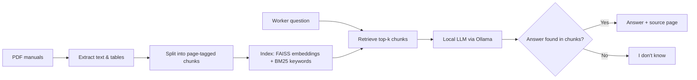

# FactoryDocs Assistant

**A Retrieval-Augmented Chatbot for Production and Logistics Manuals**

> Case Study: Intelligent Systems in Production (MDM-2) · Deggendorf Institute of Technology (THD)
> Track: Software & Simulation · Lecturer: Hamidreza Heidari, PhD


---

## About the project

Factory and warehouse workers often need quick answers, such as *"What is the robot's maximum payload?"* or *"How often must forklift brakes be checked?"* These answers are buried in manuals with hundreds of pages. Searching by hand is slow, and general AI chatbots can give confident but wrong answers, which can damage machines or hurt people.

**FactoryDocs Assistant** is a chatbot that answers questions **only** from verified manuals, using Retrieval-Augmented Generation (RAG):

- Finds the relevant part of the manual
- A local language model writes a short answer
- **Every answer shows the source page**
- If the answer is not in the manuals, it says **"I don't know"** instead of guessing
- Runs **locally** with Ollama, so documents never leave the computer

## How it works



## What we compare

All four approaches are tested on the same question set:

| # | Approach | Description |
|---|----------|-------------|
| 1 | Plain LLM | No retrieval, answers from the model's memory (shows hallucination risk) |
| 2 | BM25 RAG | Keyword search baseline |
| 3 | Dense RAG | Meaning-based search with sentence embeddings |
| 4 | Hybrid RAG | BM25 + dense search combined (handles error codes and part numbers) |

We also test different chunk sizes and top-k values.

## Evaluation

**Test set:** 60 team-written questions in 5 types: fact, table value, procedure, safety rule, and unanswerable.

| KPI | What it measures | Target |
|-----|------------------|--------|
| Retrieval hit rate@5 | Correct page is among the top 5 retrieved chunks | ≥ 80% |
| Answer accuracy | Answer judged correct (3-level rubric, 2 reviewers) | ≥ 75%, beats baselines |
| Refusal rate | Says "I don't know" on unanswerable questions | ≥ 80% |
| Response time | Median seconds per answer on a laptop | ≤ 10 s |

Targets are goals; final results will be added here after the experiments.

## Data

We use public manuals from production and logistics. **The PDFs are not stored in this repository** (copyright); download them from the original sources and place them in `data/raw/`.

| Domain | Document | Source |
|--------|----------|--------|
| Production | Universal Robots UR5e User Manual | Universal Robots website *(link to be added)* |
| Logistics | OSHA Powered Industrial Trucks (29 CFR 1910.178) | [osha.gov](https://www.osha.gov/laws-regs/regulations/standardnumber/1910/1910.178) |
| Production | Conveyor or CNC manual | *(to be selected)* |

## Tech stack

| Purpose | Tool |
|---------|------|
| PDF extraction | pdfplumber (PyMuPDF as backup) |
| Embeddings | sentence-transformers |
| Vector search | FAISS |
| Keyword search | rank-bm25 |
| Language model | Ollama (e.g., Llama 3 8B), runs locally |
| Evaluation | pandas, RAGAS |
| Demo app | Streamlit |

## Repository structure (planned)

```
├── data/
│   ├── raw/              # downloaded PDFs (not committed)
│   ├── processed/        # extracted, chunked text
│   └── test_set.csv      # 60 evaluation questions with answers
├── src/
│   ├── extract.py        # PDF text and table extraction
│   ├── chunk.py          # page-tagged chunking
│   ├── index.py          # FAISS and BM25 indexes
│   ├── retrieve.py       # BM25, dense and hybrid retrieval
│   ├── generate.py       # LLM answering with citations / refusal
│   └── evaluate.py       # KPI calculation
├── app/
│   └── app.py            # Streamlit chat demo
├── results/              # metrics, tables, error analysis
├── docs/                 # proposal, slides, report
├── requirements.txt
└── README.md
```

## Getting started (planned)

These commands will work once the code is added.

```bash
# 1. Clone the repository
git clone https://github.com/Shilpa-Golla/FactoryDocs-Assistant-A-Retrieval-Augmented-Chatbot-for-Production-and-Logistics-Manuals.git
cd FactoryDocs-Assistant-A-Retrieval-Augmented-Chatbot-for-Production-and-Logistics-Manuals

# 2. Install Python packages
pip install -r requirements.txt

# 3. Install Ollama (https://ollama.com) and download a model
ollama pull llama3

# 4. Put the manuals in data/raw/, then build the index
python src/index.py

# 5. Start the chat app
streamlit run app/app.py
```

## Milestones

| Phase | Date | Deliverable | Status |
|-------|------|-------------|--------|
| P1 | 20 Oct 2026 | Proposal, tech stack, MVP definition | ✅ |
| P2 | 03 Nov 2026 | Literature review, PDF extraction, BM25 baseline, test plan | ⏳ |
| P3 | 24 Nov 2026 | Embeddings + FAISS, first cited answers, plain-LLM baseline | ⏳ |
| P4 | 08 Dec 2026 | Test set complete, hybrid search, comparison + error analysis | ⏳ |
| P5 | 22 Dec 2026 | Streamlit demo, demo video, run instructions | ⏳ |
| Final | 12 Jan 2027 | IEEE report and final presentation | ⏳ |

## Team

| Name | Role |
|------|------|
| Divi Teja Dimmiti | Team Lead · RAG pipeline and LLM integration |
| Shilpa Golla | PDF extraction and test set |
| Vijay Boyapati | Evaluation and Streamlit demo |

## Safety notice

FactoryDocs Assistant is a **decision aid** for a university project. It is not a replacement for official manuals or safety procedures. Always check the cited page and follow your company's safety rules.

## References

1. P. Lewis et al., "Retrieval-Augmented Generation for Knowledge-Intensive NLP Tasks," *NeurIPS*, 2020.
2. Y. Gao et al., "Retrieval-Augmented Generation for Large Language Models: A Survey," arXiv:2312.10997, 2023.
3. S. Es et al., "RAGAS: Automated Evaluation of Retrieval Augmented Generation," *EACL (Demos)*, 2024.
4. N. Reimers and I. Gurevych, "Sentence-BERT: Sentence Embeddings using Siamese BERT-Networks," *EMNLP*, 2019.
5. J. Johnson, M. Douze and H. Jégou, "Billion-scale similarity search with GPUs," *IEEE Trans. Big Data*, 2019.
6. S. Robertson and H. Zaragoza, "The Probabilistic Relevance Framework: BM25 and Beyond," *Found. Trends Inf. Retr.*, 2009.
